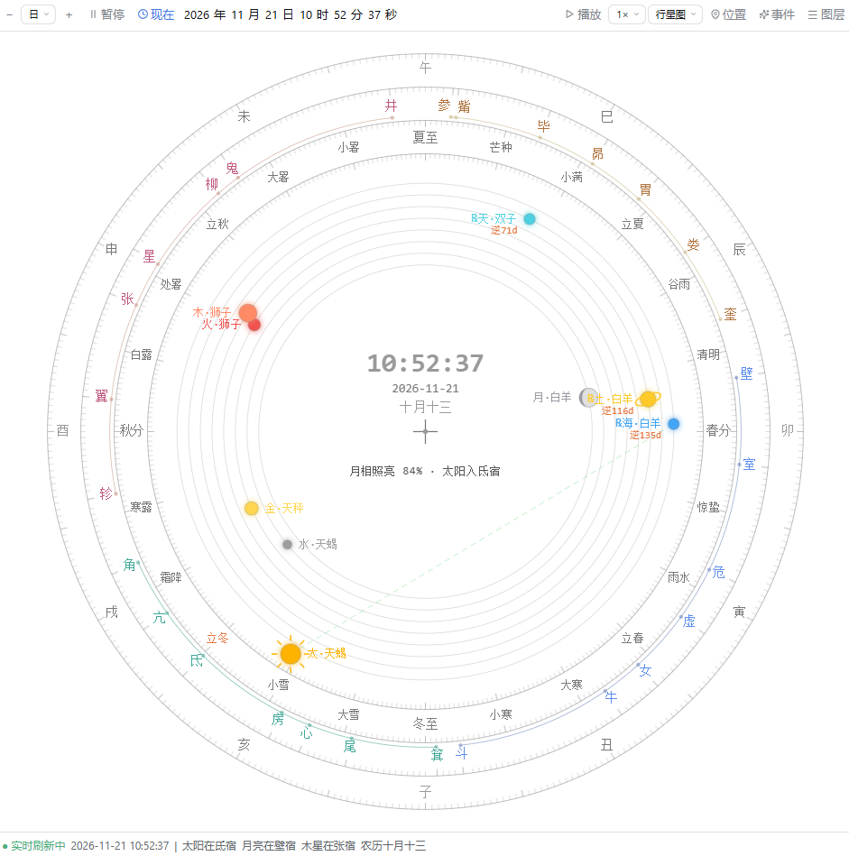

# dsh-sky-panel 星图面板

[English](README_EN.md)

 

DSH（DeepSeek Harness）右侧栏「星图」Tab——一个中国天文体系与现代行星历元并置的仪表盘圆图：
以二十八宿距星不等分刻度为主刻度环，配十二辰、二十四节气、黄道圈与七曜行星，可逐分钟/逐日/逐月
推演天象，内置农历与节气，附带地平坐标天顶图与未来 30 天天象事件日历。

## 功能特性

（以下对照 `lib/src/ui.js` 实际实现）

- **双视图圆图**
  - **图① 行星图**：黄经统一坐标轴的圆图——十二辰外圈（r340，六方位色带环）、28 宿圈（r310，距星
    黄经不等分刻度+宿名四象分色）、24 节气圈（r280，当前节气高亮）、黄道圈（r250）、行星带（r150-234
    九体等距半径带）、中心信息区（时钟/日期/农历/月相照亮百分比/太阳入宿）。
  - **图② 天顶图**：地平坐标投影——**上南下北左东右西**（仰望天图惯例），方位标为中文「北/东/南/西」
    十字 + 30° 主/15° 中/1° 细方位刻度与度数标注；天顶圆心/地平圈、30°/60° 高度参考圈；可见性着色
    （地下天体压缩窄带 + 标注 × 前缀）；民用/航海/天文三层晨昏蒙影虚线圆；九体行星与图①同款完整特效
    （太阳芒/土星环/月亮 glyph 共享绘制函数）。
- **六段时刻输入行**：年/月/日/时/分/秒六段分段点击编辑——点谁谁变输入框，编辑中点其他段=提交当前段
  并直切；各段越界自动钳制（月 1-12/日 1-31/时 0-23/分秒 0-59）；**年开放公元前**：显示 B 前缀
  （B2000=公元前 2001 年，天文计数），输入认 `B2000`/`-2000`/`2000` 三形式，下限 -7000
  （Astronomy Engine 引擎边界对齐）。
- **±时间三件套**：工具栏 `−[单位▾]＋`——步长单位下拉（分/时/日/月/年），± 按钮按当前单位平移
  （与 D/F、N/M、J/K 快捷键同后端；年平移保持月日、闰二月自动钳制）。
- **自造下拉组件**：全部下拉（步长单位/播放速度/视图/城市预设）为自造 `SkyDrop`——形态对齐 DSH 原生
  下拉：无边框菜单 + 外圈阴影 + Lucide chevron（展开旋转 180°、当前项高亮、遮罩点击关闭）——不依赖
  原生 `<select>`。
- **Lucide 图标体系**：播放控件三组两态（播放 ▶/暂停 ⏸、实时 radio/暂停、现在 clock）与位置 pin、
  事件 sparkle 均为内联 Lucide SVG（12px 线性 stroke=currentColor，随主题色跟随）。
- **动画播放**：▶ 100ms 节拍虚拟时间推进（1×/100×/1000×），与实时刷新互斥，任意时间操作自动暂停。
- **事件日历**：未来 30 天日月食（月食全/偏/半影、日食全/环/偏/混合）、行星合（21 对黄经差跨 0°
    二分细化到分钟）、外行星冲日（跨 ±180°）、水金大距（日采样局部极大，距日 >15° 才报）；按日缓存。
- **18 项图层面板（四列）**：十二辰外圈/色带/辰名、四圈 1° 细刻度、28 宿圈/宿度数字/星官连线、节气圈、
    黄道圈、行星轨道圈、行星连线、行星标注/星座名/逆行标记、月相、中心信息/地心标——四列网格布局，
    开关即存 localStorage。
- **键盘快捷键**：面板聚焦（点击画布）后可用（见下表）。
- **悬停与详情卡**：悬停任意行星出仪表读数 tooltip（行星图：黄经度分秒/入宿/黄纬/距离/星等/顺逆/时角/
    地平；天顶图：高度/方位/可见性/升落）；点击弹出详情卡（含距离百分比条与今日升/中/落时刻）。
  **升/中/落时刻观测地跟随「位置」面板**（getPosition 持久化观测地，位置变更自动重算）。
- **双主题**：底色零自定义，全部文字/刻度/边框色每帧读 DSH CSS 变量——深浅主题自动跟随。
- **四象星官连线**：青龙/玄武/白虎/朱雀七宿距星沿 r284 走廊弧线四色连线。

### 键盘快捷键

| 键 | 作用 | 键 | 作用 |
|----|------|----|------|
| `J` / `←` | 前一日 | `K` / `→` | 后一日 |
| `N` / `↓` | 前一小时 | `M` / `↑` | 后一小时 |
| `D` | 前一分钟 | `F` | 后一分钟 |
| `H` | 回到现在并恢复实时 | `Space` | 播放⇄暂停；实时态按一次=暂停 |
| `E` | 退时间跨度（面板中设定跨度值+单位） | `R` | 进时间跨度 |

另有工具栏：六段时刻输入行 +「今」回实时按钮、±时间三件套 `−[单位▾]＋`、暂停/实时、现在、
播放+速度、视图切换、位置、事件、图层。

## 安装

DSH 插件安装：

1. 将本目录置于插件资产区（或任意 DSH 可读路径）；
2. 在对应 profile 的组合配置中声明本包（`exports` 面向 `lib/index.js` + `lib/client.js`，DSH 客户端
   按 `package.json` 的 `dsh.client.platform: "web"` 以 classic `<script>` 装载 `lib/client.js`）；
3. 无需构建步骤——`lib/client.js` 为已提交产物；仅当修改源码后需要重跑 build（见「开发」）。

## 使用

- 打开 DSH 右侧栏「星图」Tab，默认实时刷新（1 秒节拍）。
- 点击画布使其获得焦点后即可用键盘快捷键；悬停行星看读数，点击行星开详情卡，点击空白关闭。
- 「☰ 图层」展开 18 项图层开关与 E/R 时间跨度设定；「☀ 事件」展开 30 天天象日历；
  「◎ 位置」切换观测地（城市预设或手输经纬度——影响天顶图、地平读数与升/中/落时刻，持久化
  localStorage）。
- 「▶ 播放」+ 速度下拉（1×/100×/1000×）做时间推进动画；任何时间操作自动暂停播放。

## 天文体系说明

- **黄经口径**：全图统一黄经坐标轴——冬至 270° = 正下，黄经增 = 逆时针（天左旋）；夏至 90° = 正上。
- **28 宿不等分**：宿界由距星赤经差按 365.25 度日制推算（宿度差值法），觜宿最窄（<2.5°）、井宿最宽
  （>25°），与传统宿度口径一致；圈上刻度即距星黄经，非等分。
- **十二辰**：子=冬至=正下，每辰 30°；六方位色带（子丑深蓝/寅卯绿/辰巳青/午未红/申酉金/戌亥紫）。
- **24 节气**：锚冬至 270°，每 15° 一气，当前节气（太阳所在区间）橙色高亮。
- **四象星官**：青龙 0-6 宿 / 玄武 7-13 / 白虎 14-20 / 朱雀 21-27，宿名四色分组。
- **数据表 `knowledge/28xiu-stars.js` 字段**：
  - `X28_STARS[]`：`xiu` 宿名 / `star` 中西星名 / `bayer` Bayer designation / `ra` J2000 赤经（小时）/
    `dec` J2000 赤纬（度）；
  - `BRIGHT_STARS[]`：命名亮星（大角/天狼/织女等），同上字段；
  - `PLANET_DIST`：行星日心距离界（推地心近远点百分比用）；`X28_NAMES`/`X28_BOUNDS`：宿名序与宿界。

## 数据与致谢

1. **天文计算引擎**：[Astronomy Engine](https://github.com/cosinekitty/astronomy) by Don Cross（MIT
   License），npm 发布线 v2.1.19（注：GitHub release 号与 npm 发布号不同源，以 npm 线为准）——行星/月亮位置、升落中天、日月食、节气黄经、朔望月等全部天体计算由其完成。
2. **二十八宿距星数据**：28 颗距星 J2000 坐标，取自 Hipparcos 星表（经 [SIMBAD](https://simbad.cds.unistra.fr/simbad/) 查询核对）。距星选择遵循中国传统星官体系（与西方 Bayer 编号不一一对应，如参宿一距星为 ζ Ori 而非 δ Ori）
   （28/28 全部一致），见 `knowledge/28xiu-stars.js`。
3. **农历/节气算法**：基于 Astronomy Engine 内置朔（`SearchMoonPhase`）与中气（`SearchSunLongitude`）
   搜索实现——朔望月分月、冬至所在月=十一月（建子）、无中气之月=闰月、日界东八区；2020-2030 共 433
   样本 golden 对照全对。
4. **测试对照数据**：`test/golden/` 农历 golden 样本的正确性基准参考了《寿星天文历》（许剑伟）的
   推算结果——谨致谢意（仅作测试对照，未使用其代码）。

## 设计

- **DSH CSS 变量主题跟随**：面板底色/文字/边框全部取 `--dsw-alias-*` 变量，零自定义底色，深浅主题
  每帧自动跟随。
- **720 设计坐标系**：所有绘制按 720×720 设计坐标书写，`resizeTo` 按显示尺寸×devicePixelRatio×视图
  scale 动态设置 backing 并 `setTransform` 等比映射——任何侧栏宽度下原生分辨率渲染。
- **IBM Carbon 行星功能色**：九体行星采用固定 RGB 功能色（太阳 #FFB300 / 火星 #EF5350 / 海王星
  #42A5F5 等），口径取自 IBM Carbon 开源设计体系科学色板，不随主题变化。
## License

MIT — 见 [LICENSE](LICENSE)。内含 Astronomy Engine（MIT, © Don Cross，npm 线 v2.1.19）；第三方声明见 LICENSE 附录。
