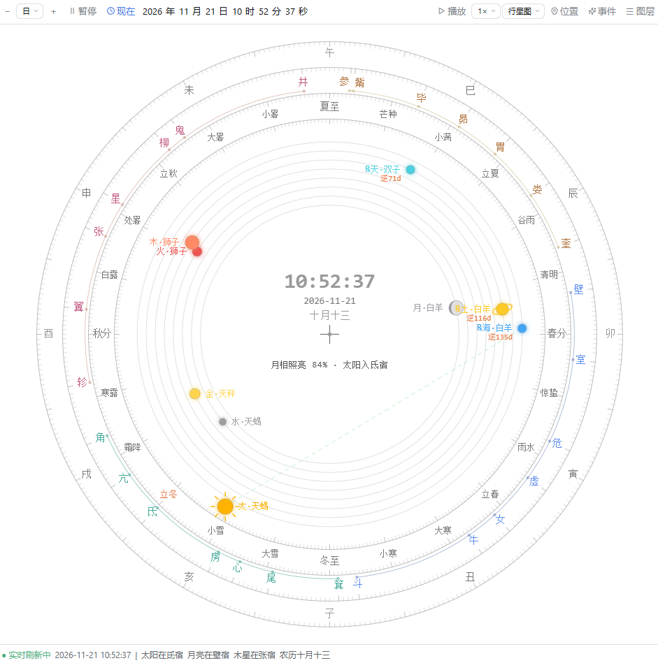

# dsh-sky-panel — Star Chart Panel

[中文说明](README.md)

 

An astronomy panel for the right sidebar of **DSH (DeepSeek Harness)**: a Chinese-tradition
star chart side by side with modern planetary ephemerides — a 720-design-coordinate circular
chart anchored on the Twenty-Eight Lunar Mansions (二十八宿) with unequal mansion divisions,
the twelve time-branches (十二辰), 24 solar terms, ecliptic ring and the seven luminaries plus
modern planets; a second horizon-coordinate zenith chart; built-in Chinese lunar calendar;
and a 30-day celestial-event calendar.

## Features

- **Dual-view circular charts** — ① Planetary chart on a unified ecliptic-longitude axis
  (12-branch outer ring with directional color bands, 28-mansion ring with determinative-star
  unequal ticks, 24 solar-term ring, ecliptic ring, nine-body planet bands, central info);
  ② Zenith chart in horizon coordinates (N up in the chart follows the sky-viewing convention;
  altitude reference circles, twilight zones, visibility shading).
- **Six-segment time input** (year/month/day/hour/minute/second) with per-segment clamping;
  BCE years supported down to -7000 (astronomical year counting, e.g. B2000).
- **Time stepping** ±minute/hour/day/month/year, keyboard shortcuts, and playback animation
  (1×/100×/1000×).
- **Event calendar** — next-30-day eclipses (lunar/solar by type), planetary conjunctions
  (21 pairs), oppositions, greatest elongations of Mercury/Venus.
- **18 toggleable layers**, hover tooltips with full instrument readouts, planet detail cards
  with rise/transit/set times; observer location switchable (city presets or manual
  lat/long, persisted).
- **Theme-following UI** — all colors read host CSS variables every frame; light/dark themes
  tracked automatically. Planet functional colors from the IBM Carbon science palette.

## Install

1. Place this directory in your DSH plugin assets area (any DSH-readable path);
2. Declare the package in the profile composition config (`exports` → `lib/index.js` +
   `lib/client.js`; the DSH client loads `lib/client.js` as a classic script per
   `dsh.client.platform: "web"` in `package.json`);
3. No build step required — `lib/client.js` is committed. Rebuild only after editing sources
   (see Development).

This panel runs inside the DSH host; it is not a standalone web page.

## Usage

Open the "星图" tab in the DSH right sidebar. Click the canvas to focus it for keyboard
shortcuts; hover planets for readouts; click a planet for its detail card. Layers, events,
and observer location live behind the toolbar buttons.

## Astronomy notes

- Ecliptic longitudes use a unified axis: winter solstice = 270° = bottom; longitude
  increases counter-clockwise.
- Mansion boundaries follow the determinative-star RA differences (365.25-day system);
  widths range from <2.5° (觜宿) to >25° (井宿), consistent with traditional mansion widths.
- Lunar calendar is computed in-engine from Astronomy Engine new-moon and major-term
  searches (winter-solstice month = month 11; no-major-term month = leap month; UTC+8 day
  boundary); 433 golden samples for 2020–2030 all pass.

## Data & acknowledgments

1. **Astronomy Engine** by Don Cross (MIT) — npm line v2.1.19 (note: GitHub release numbers
   and npm release numbers differ; the npm line is authoritative). All celestial computation.
2. **28 mansion determinative stars** — J2000 coordinates in `knowledge/28xiu-stars.js`;
   the coordinate frame was studied against the Hipparcos catalogue (known systematic
   differences exist — the traditional Chinese determinative-star system is followed).
3. Lunar/solar-term algorithm — original implementation on top of Astronomy Engine
   primitives.
4. **Test oracle** — correctness baselines in `test/golden/` were cross-checked against
   results from 寿星天文历 (sxwnl) by 许剑伟. Used for testing only; no code reused.

## Development

`lib/client.js` is generated by `test/build-client.cjs` from `lib/src/ui.js`,
`knowledge/` and the vendored engine. After editing sources, run the build, then the
verify suite (187 anchor checks):

    node test/build-client.cjs
    node test/verify-client.cjs

## License

MIT — see [LICENSE](LICENSE). Includes Astronomy Engine (MIT, © Don Cross, npm line v2.1.19);
third-party notice appended to the LICENSE file.
